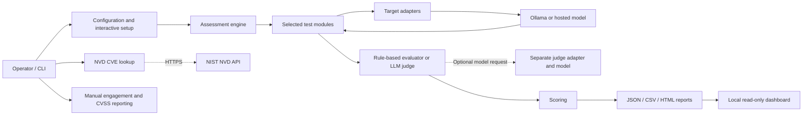

# AI Red Team Assessment

This project includes an assessment CLI, model adapters, engagement scope
records, CVSS scoring for manually entered findings, and HTML reporting.

Assess only systems for which you have explicit authorization. Review the
selected tests, request limits, configuration, and data-handling requirements
before connecting to a model.

## Architecture



The assessment engine orchestrates configured tests, sends prompts through the
selected target adapter, evaluates responses, then writes reports. A judge is
optional and can use a separate provider. CVE lookup and manually entered
engagement reporting are separate workflows; CVE lookup does not determine
whether a target is affected. Hosted services can receive sensitive inputs;
review provider policies and data handling before use.

## Project layout

- `config/`: target, judge, reporting, and test configuration.
- `core/`, `adapters/`, and `attacks/`: assessment engine and modules.
- `pentest/`: authorization scope records, manual CVSS scoring, and reports.
- `data/`: empty data directories and inert example files.
- `dashboard/`, `tests/`, and `main.py`: dashboard, tests, and CLI.

## Connecting models from PowerShell

Run these commands from the project directory:

```powershell
python -m venv .venv
.\.venv\Scripts\python.exe -m pip install -r .\requirements.txt
.\.venv\Scripts\python.exe .\main.py --help
.\.venv\Scripts\python.exe .\main.py --list
```

For an interactive choice between a local Ollama model and a hosted API:

```powershell
python .\main.py --interactive --check-target
```

Choose `1` for local Ollama and enter a model already installed (`ollama list`).
The local selection uses `http://localhost:11434`. `--check-target` sends one
health check only and does not select or test a judge.
Once it succeeds, use `python .\main.py --interactive --quick` to start an
assessment after reviewing its scope. Choose rule-based evaluation, a local
Ollama judge, or a hosted API judge independently of the target. For example,
a local target can be evaluated by an OpenAI, Anthropic, or DeepSeek judge.
Rule-based evaluation and a local Ollama judge need no cloud API key.
Interactive choices apply only to that run; they do not modify the config file.

Choose `2` for an API and select a catalog profile or `anthropic`. Set the
displayed key environment variable before starting the command. A hosted
judge requires explicit confirmation because it receives test prompts,
responses, and potentially system instructions, and may incur charges.
Use `--no-judge` to select rule-based evaluation without a judge prompt.
The interactive mode cannot be
combined with provider/model selection flags; omit `--interactive` for
scripted config-driven runs.

For OpenAI, set `OPENAI_API_KEY` in your PowerShell environment, then check
the connection with:

```powershell
.\.venv\Scripts\python.exe .\main.py --provider openai --model YOUR_MODEL_ID --check-target
```

Replace `YOUR_MODEL_ID` with a model available to your account. For another
provider implementing the OpenAI Chat Completions API, use `--provider openai`,
its model ID, `--base-url https://YOUR-TRUSTED-ENDPOINT/v1`, and optionally
`--api-key-env YOUR_KEY_ENV`. Only use a trusted endpoint: the configured API
key is sent to that endpoint. Not every provider or model implements this API
or supports the same generation parameters.

For Anthropic, set `ANTHROPIC_API_KEY` and use:

```powershell
.\.venv\Scripts\python.exe .\main.py --provider anthropic --model YOUR_MODEL_ID --check-target
```

For a downloaded local model, install and start Ollama separately, then:

```powershell
ollama pull llama3.2
.\.venv\Scripts\python.exe .\main.py --provider ollama --model llama3.2 --check-target
```

Ollama defaults to `http://localhost:11434`; use `--base-url` to change it.
`--check-target` sends one health-check prompt and does not run an assessment.
Changing providers requires `--model`. Provider options also apply to assessment
commands; omit `--check-target` only after reviewing the selected tests and
configuration. Use `--no-judge` if you do not want a separate judge model.
Otherwise the judge remains configured independently in `config/config.yaml`
and may send prompts and responses to another provider. API calls may incur
charges and transmit test content, system prompts, and model responses.
Keep API keys in environment variables, never in configuration files.

### OpenAI-compatible provider catalog

The [provider catalog](config/providers.yaml) has connection profiles for
OpenAI, DeepSeek, and OpenRouter. It is not a copy of the Artificial Analysis
leaderboard or an exhaustive list of its models. Listing profiles is offline:

```powershell
.\.venv\Scripts\python.exe .\main.py --list-providers
```

Set the relevant key in the current PowerShell session, then supply an actual
model ID available through that provider:

```powershell
$env:DEEPSEEK_API_KEY = Read-Host "DeepSeek API key"
.\.venv\Scripts\python.exe .\main.py --provider-profile deepseek --model deepseek-flash --check-target
```

The key is never stored in the catalog. For OpenRouter, set
`OPENROUTER_API_KEY` and use an OpenRouter model ID. Available models and
parameter compatibility change; consult the provider's current model list.
Model developers on a leaderboard are not necessarily API hosts, and a model
may not be available through a given provider or account.

To add another OpenAI Chat Completions-compatible provider, add a profile:

```yaml
  my_provider:
    base_url: https://api.example.com/v1
    api_key_env: MY_PROVIDER_API_KEY
```

Add it beneath `providers` in the catalog, replacing the example URL with the
provider's actual trusted HTTPS API base URL. Then set the named environment
variable and use `--provider-profile my_provider --model YOUR_MODEL_ID`.
Profiles cannot be mixed with `--provider`, `--base-url`, or `--api-key-env`:
this prevents accidentally sending a profile's key to a different endpoint.
For another catalog file, use `--provider-catalog PATH`. Custom protocols and
model-specific API parameters are not automatically supported.

Manual findings reports are separate and do not verify vulnerabilities.

## CVE lookup

Query the NIST National Vulnerability Database on demand from PowerShell:

```powershell
python .\main.py --cve CVE-2021-44228
python .\main.py --cve "ollama" --cve-days 90 --cve-limit 10
```

Keyword searches show the most recently published matches in the specified
window (1–120 days; default 30), up to the limit (1–100; default 10). NVD
records can change and may lack a CVSS score or English description. An optional
NVD API key can be supplied through the `NVD_API_KEY` environment variable.
Requests send the search term to NVD; do not include sensitive information.
This lookup does not scan deployments, compare installed versions, or add
findings to reports. Verify affected products, versions, and vendor advisories
before drawing conclusions. API/network errors are reported explicitly.

Data source: [NVD CVE API](https://nvd.nist.gov/developers/vulnerabilities).

## Report storage and retention

The example configuration writes JSON, CSV, and HTML for every assessment to
`reports/output`; this creates three files per run. Set `reporting.formats` in
`config/config.yaml` to only the formats you need, for example `[json]`. The
dashboard reads JSON. Avoid keeping sensitive test data longer than needed:
JSON and CSV reports can contain prompts and responses.

Automatic retention is **off by default**. To enable it, set:

```yaml
reporting:
  retention:
    enabled: true
    days: 30
```

After all selected reports have been generated successfully, the tool deletes
only regular files directly in the configured output directory whose names
match its generated timestamped report patterns and whose modification time is
older than the specified number of days. Deletion is permanent; unrelated
files, subdirectories, and symlinks are skipped. Errors are surfaced. This
policy does not clean logs, manual pentest reports, or external backups; manage
those separately. Retention is age-based, not a hard size quota.

`include_raw_responses` is not currently enforced by the report generator.
Do not rely on it for redaction; treat stored reports as sensitive.

## Linux shell and executable builds

On Linux or macOS, with Python and the runtime requirements installed:

```sh
sh scripts/run.sh --help
sh scripts/run.sh --interactive --check-target
```

## Running tests

Use an isolated virtual environment to avoid conflicts with other Python
projects. From the project directory on Windows:

```powershell
python -m venv .venv
.\.venv\Scripts\python.exe -m pip install -r .\requirements-test.txt
.\.venv\Scripts\python.exe -m pip check
.\.venv\Scripts\python.exe -m pytest -q
```

GitHub Actions runs the tests on pushes, pull requests, and release tags.
Release builds and publication proceed only if the tests pass.

## Executable builds

To build a distributable executable folder, install build dependencies in a
virtual environment on the **same operating system and CPU architecture** as
the target. PyInstaller does not cross-compile. The executable folder includes
support files and must be kept intact; configuration, judge templates, and
provider catalog remain external and are read relative to the project working
directory. It is not a single self-contained file.

Windows PowerShell:

```powershell
python -m venv .venv
.\.venv\Scripts\python.exe -m pip install -r .\requirements-build.txt
$env:PATH = "$PWD\.venv\Scripts;$env:PATH"
.\scripts\build-executable.ps1
.\dist\ai-redteam\ai-redteam.exe --help
```

Linux:

```sh
python3 -m venv .venv
. .venv/bin/activate
python -m pip install -r requirements-build.txt
sh scripts/build-executable.sh
./dist/ai-redteam/ai-redteam --help
```

Run the executable from the project directory so relative config, template,
log, and report paths resolve. Build artifacts in `build/` and `dist/` may be
large and can be removed separately after retaining the files you need.

### GitHub release downloads

When this project is hosted on GitHub, pushing a tag such as `v1.0.0` triggers
the release workflow. It builds and smoke-tests separate Windows x64 and Linux
x64 executable folders, packages the external `config/` directory, and
publishes ZIP and `.tar.gz` assets to a GitHub Release. Extract the appropriate
archive, change into the extracted folder, and run `ai-redteam.exe` on Windows
or `./ai-redteam` on Linux. No Python installation is needed on the target
machine; the full extracted folder must remain together.

On Windows, double-click `Open Dashboard.cmd` in the extracted folder to open
the read-only report dashboard in your browser. Keep its console window open
while viewing reports; press Ctrl+C in that window to stop the server. It reads
JSON reports in that release folder's `reports/output` directory. Reports
stored elsewhere are not copied automatically. The launcher is a browser
viewer, not an installer and not a control panel for starting assessments.

After committing and pushing your changes, create and push a version tag:

```powershell
git tag v1.0.0
git push origin v1.0.0
```

GitHub Actions must be enabled and permitted to create releases. Tag pushes
trigger publication, not ordinary branch pushes. Release archives contain
sample configuration: inspect it and set API keys in the environment rather
than committing or packaging secrets. Docker images are not published by this
workflow.

## Docker isolation

The image uses a non-root user and excludes local reports, logs, virtual
environments, and environment files from the build context. Build and verify:

```powershell
docker build -t ai-redteam .
docker run --rm --network none --read-only --tmpfs /tmp ai-redteam --help
```

For an assessment, use persistent volumes for reports and logs and grant only
the network access required for the authorized target. For example, on Docker
Desktop, if Ollama is reachable from the container:

```powershell
docker run --rm --read-only --tmpfs /tmp `
  --mount source=ai-redteam-reports,target=/app/reports/output `
  --mount source=ai-redteam-logs,target=/app/logs `
  ai-redteam --provider ollama --model llama3.2 `
  --base-url http://host.docker.internal:11434 --no-judge --check-target
```

Inside a container, `localhost` refers to the container, not the host. The
interactive local option always uses container localhost; use the explicit
`--base-url` shown above for a host service. On Linux, host access can require
`--add-host host.docker.internal:host-gateway` and an Ollama listener configured
to accept connections from the container. Restrict its exposure appropriately.
For interactive terminal prompts, add `-it`. Hosted API keys should be supplied
through approved runtime secret handling, not baked into images. Docker provides
process/filesystem isolation, not a complete security boundary; apply network
policy and resource limits appropriate to the deployment.

## Enterprise readiness roadmap

Before enterprise production use, add and validate: strong authentication and
authorization, scope enforcement, per-engagement request/cost budgets,
centralized audit logs, secret management, encrypted storage, data redaction,
retention/backup policies, reliable error handling, signed reproducible builds,
dependency scanning, and CI integration. Validate findings with human review and
maintain provider-specific tests. The current tool is not enterprise-certified.

## Offline prompt-injection checks

Run `python -m pytest tests/test_prompt_injection_offline.py` to evaluate the
prompt-injection rule-based classifier against canned responses. These tests
generate test cases and evaluate local text only; they do not initialize an
adapter, call a target, or make network requests.

## Offline bias comparison

`attacks.bias.compare_responses` compares two locally supplied responses to
matched prompts. It flags differing refusal behavior or a configurable
response-length ratio as a *potential* disparity, not proof of bias. Run
`python -m pytest tests/test_bias_offline.py` to test the comparator. It does
not call a model or make network requests.

## Offline toxicity checks

`attacks.toxicity.ToxicityElicitation` provides safe de-escalation test prompts
and checks manually supplied responses against an operator-configured marker
lexicon. Marker matching is only a review signal, not a complete toxicity
classifier. No model or network is called. Run
`python -m pytest tests/test_toxicity_offline.py` to test the module.

## Local report dashboard

Run `python -m dashboard.app` to view generated JSON reports from
`reports/output` at `http://127.0.0.1:8765/`. The viewer binds to loopback only,
is read-only, and intentionally omits prompts and raw responses. Use
`--report-dir` or `--port` to select a report directory or local port. To launch
the viewer from the main CLI and open the browser automatically:

```powershell
python .\main.py --dashboard --report-dir .\reports\output --dashboard-port 8765
```

In an extracted release, use `.\ai-redteam.exe --dashboard` instead of Python.
The viewer has no authentication; other processes and users on the same
machine may be able to access it while it is running. Stop it when not needed.
Report descriptions and findings may still be sensitive.

```text
# ==========================================
# RUNNING ASSESSMENTS
# ==========================================

# List available attacks
python main.py --list

# Full OWASP assessment with LLM judge
python main.py --config config/config.yaml

# Quick scan (5 tests per category)
python main.py --quick

# Specific categories only
python main.py --categories llm01_prompt_injection llm07_system_prompt_leakage

# Rule-based only (no judge LLM costs)
python main.py --no-judge

# Custom output directory
python main.py --output-dir ./my_reports

# Limit tests per category
python main.py --max-tests 10

# ==========================================
# CI/CD INTEGRATION
# ==========================================
# Exit codes:
#   0 = Pass (no high/critical findings)
#   1 = High severity findings
#   2 = Critical findings
```
